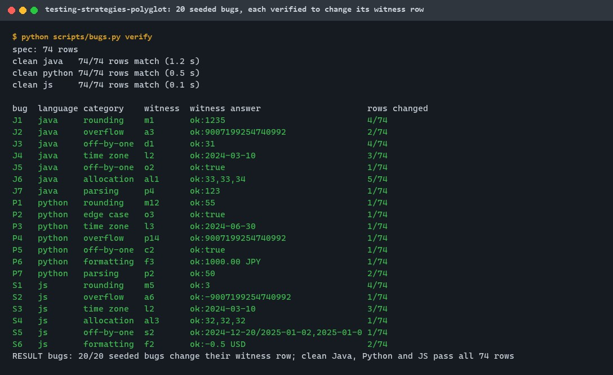
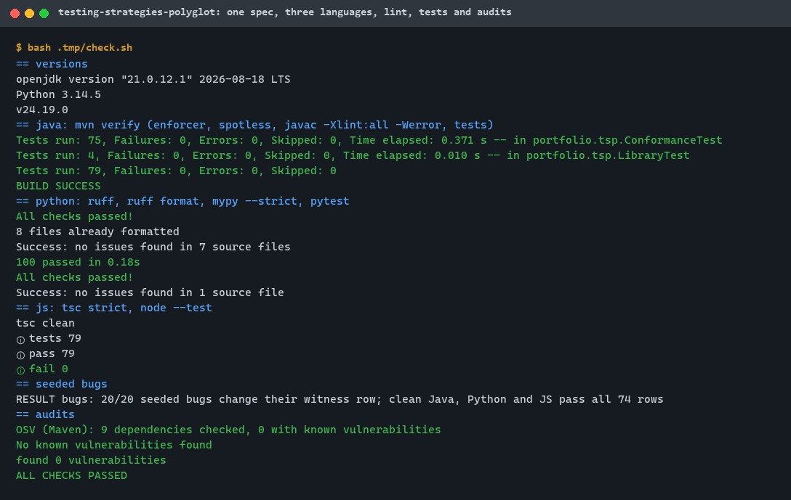
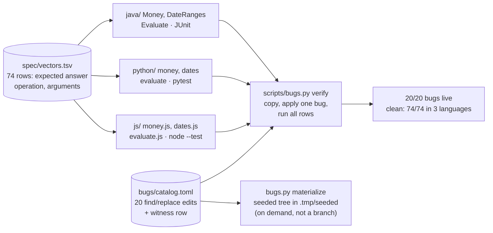
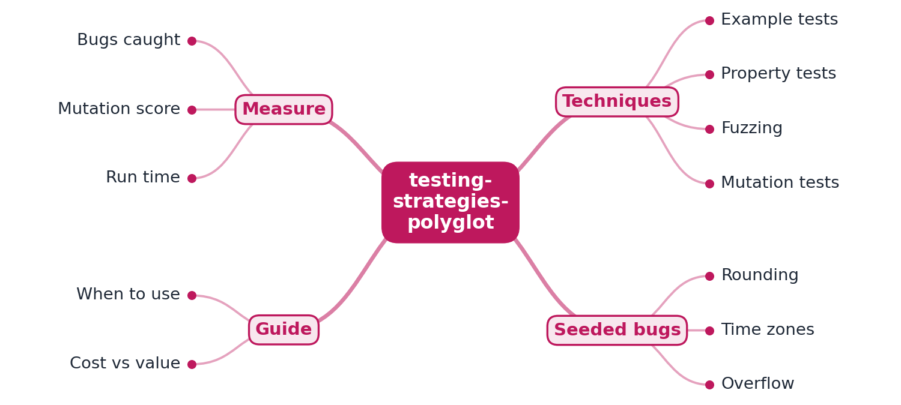

# testing-strategies-polyglot

[](https://github.com/EquinoxWN/testing-strategies-polyglot/actions/workflows/ci.yml)


> Why bugs still ship at 90% coverage, step one: one small library in three languages held to one spec, with 20 realistic seeded bugs as the yardstick for comparing testing techniques.

Part of my **CS Foundations** list · Java · Python · JS

## Proof it works

The same money and date-range library is written in Java, Python and JavaScript. All three answer
the 74 rows of one shared specification identically. Twenty realistic bugs are seeded as checked
patches, and the harness proves each one changes a result. 11 of them change only a single row of
the 74:



258 tests pass across the three languages. Lint and strict type checks are clean in each, and OSV,
pip-audit and npm audit find no known vulnerabilities:



## Architecture

**What M1 runs today:**



**Full roadmap (M1 to M3):**



## How it works

_Steps 1 and 2 are built and tested (M1); the rest is on the [roadmap](#roadmap)._

1. The same small library (money arithmetic and date ranges) is written in Java, Python and JavaScript.
2. Twenty realistic bugs (rounding, time zones, overflow, off-by-one) are seeded apart from the clean code (the backlog said "on a separate branch"; see [ADR 0003](docs/adr/0003-seeded-bugs-as-checked-patches.md)).
3. Each language gets example tests, property tests and mutation testing.
4. Mutation testing (PIT, mutmut, Stryker) measures how good each suite really is, beyond line coverage.
5. A matrix records which technique caught which seeded bug, and at what cost in run time.
6. A guide recommends a testing strategy per risk level, the kind of standard a Staff engineer sets for a team.

In M1, money is integer minor units (up to 2^53 - 1 in every language) with half-even rounding and
loss-free allocation. Dates are half-open ranges plus the local date of an instant in an IANA zone.
Each language has an evaluator that answers spec rows as text, so one file and one harness drive all
three ([ADR 0002](docs/adr/0002-one-spec-three-evaluators.md)). The bugs are exact find-and-replace
edits in `bugs/catalog.toml`, each with a witness row
([ADR 0003](docs/adr/0003-seeded-bugs-as-checked-patches.md)). The seeded tree is generated on
demand with `make seeded` (into `.tmp/seeded`) and is deliberately not kept as a branch: the
repository keeps a single `main` branch.

## Who it helps

- **Who:** engineering leads and staff engineers who set a team's testing standard, and developers
  comparing testing techniques in Java, Python or JavaScript.
- **The problem:** line coverage says little about whether tests catch real bugs. Most of the bugs
  here hide behind a single input (a .5 tie, a December range, a daylight-saving date), and choosing
  between techniques is usually argued from opinion.
- **What M1 does:** a realistic library and a verified bug catalog to measure techniques against.
  It shows the same behaviour in three languages from one specification, and each bug is proven to
  change a result.
- **How to use it:** run `make bugs` to see the catalog proven. Use `make seeded` for a buggy tree to
  test your own suites or tools against; add rows to `spec/vectors.tsv` to extend the spec in all
  three languages at once.

## Tech stack

| Area | In M1 | Planned |
|---|---|---|
| Java | Java 21, JUnit 6.1.3 parameterized conformance tests, Spotless, javac `-Xlint:all -Werror` | jqwik property tests, PIT (M2) |
| Python | Python 3.11+, pytest, ruff, mypy --strict, tzdata | Hypothesis, mutmut (M2) |
| JavaScript | Node.js 24, `node --test`, TypeScript 7 `checkJs` strict over JSDoc types, BigInt money | fast-check, Stryker (M2) |
| Spec and bugs | `spec/vectors.tsv` (74 rows), `bugs/catalog.toml` (20 bugs), `scripts/bugs.py` harness | Technique-by-bug matrix with run times, strategy guide (M3) |
| Audits | OSV.dev for Maven, pip-audit, npm audit | |

| Path | What it is |
|---|---|
| `spec/vectors.tsv` | The shared specification |
| `java/`, `python/`, `js/` | The three implementations, each with an evaluator and tests |
| `bugs/catalog.toml` | The twenty seeded bugs |
| `scripts/bugs.py` | `verify` (each bug live, clean code passes) and `materialize` (the seeded tree) |
| `scripts/osv_audit.py` | Maven dependency audit against OSV.dev |

## Run it

Needs JDK 21+, Maven 3.9+, Python 3.11+, Node.js 24+ and make. Dependencies install into
git-ignored folders inside the repository.

```bash
python -m venv .venv && . .venv/bin/activate   # Windows: .venv\Scripts\activate
make setup    # Maven dependencies, pip install -e "./python[dev]", npm ci
make lint     # Spotless + javac -Werror, ruff + mypy --strict, tsc strict
make test     # 258 tests in three languages
make bugs     # clean code passes all rows; each of 20 bugs changes its witness
make audit    # OSV.dev, pip-audit, npm audit
make seeded   # all 20 bugs applied, in .tmp/seeded
```

One row by hand, in any language:

```bash
printf 'multiply\t1000\tUSD\t1.2345\n' | node js/src/evaluate.js                                    # ok:1234
printf 'localdate\t2024-03-10T04:30:00Z\tAmerica/New_York\n' | python -m testing_strategies_polyglot.evaluate   # ok:2024-03-09
```

## Tests and results

Latest local run (full detail and the whole bug table in [docs/results/m1.md](docs/results/m1.md)):

| Test file | Tests | What it proves |
|---|---|---|
| `java/.../ConformanceTest.java` | 75 | All 74 spec rows in Java, and the row count |
| `java/.../LibraryTest.java` | 4 | Half-even rounding, loss-free allocation, error codes, year-end split |
| `python/tests/test_conformance.py` | 75 | All 74 spec rows in Python, and the row count |
| `python/tests/test_library.py` | 4 | The same library checks |
| `python/tests/test_bug_catalog.py` | 21 | 20 bugs split 7/7/6, required categories, each find text occurs once in clean code, each witness exists |
| `js/test/conformance.test.js` | 75 | All 74 spec rows in JavaScript, and the row count |
| `js/test/library.test.js` | 4 | The same library checks |

| Check | Result |
|---|---|
| Tests | 258 passed, 0 failed (Java 79, Python 100, JavaScript 79) |
| Lint and types | Spotless and javac `-Werror` clean; ruff and mypy --strict clean; tsc strict clean |
| Audits | OSV.dev 0 of 9 Maven dependencies; pip-audit and npm audit: 0 |
| Cross-language agreement | Java, Python and JavaScript answer all 74 rows identically |
| Seeded bugs | 20/20 change their witness row (7 Java, 7 Python, 6 JavaScript); 11 change only 1 of 74 rows |
| Categories | rounding 3, overflow 3, off-by-one 4, time zone 3, allocation 2, parsing 2, formatting 2, edge case 1 |

The full local check passed twice.

## Roadmap

**M1** (≈8 h)
- [x] Write `docs/rfc/0001-design.md`: problem, goals, non-goals, chosen design
- [x] The same small library (money arithmetic and date ranges) is written in Java, Python and JavaScript.
- [x] Twenty realistic bugs (rounding, time zones, overflow, off-by-one) are seeded apart from the clean code (as checked patches, not a separate branch; see ADR 0003).

**M2** (≈8 h)
- [ ] Each language gets example tests, property tests and mutation testing.
- [ ] Mutation testing (PIT, mutmut, Stryker) measures how good each suite really is, beyond line coverage.

**M3** (≈9 h)
- [ ] A matrix records which technique caught which seeded bug, and at what cost in run time.
- [ ] A guide recommends a testing strategy per risk level, the kind of standard a Staff engineer sets for a team.
- [ ] Publish the proof below with real numbers

The seeded bugs are kept as checked patches in `bugs/catalog.toml`; `make seeded` generates the
seeded tree on demand in `.tmp/seeded`. There is no seeded-bugs branch: the repository keeps a
single `main` branch.

## Proof

What this repo must show before it counts as done:

- The bug-by-technique matrix and mutation scores per language.

| Result | Value |
|---|---|
| Bug-by-technique matrix | Not built yet (M3) |
| Mutation scores per language | Not measured yet (M2) |

## Why it matters

- **Interview angle:** 'How would you raise quality on a team that keeps shipping bugs?' in leadership rounds.
- **Upstream I'd like to contribute to:** Hypothesis, fast-check or jqwik: documentation examples or bug fixes.

## Design docs

- [RFC 0001: design](docs/rfc/0001-design.md)
- [ADR 0001: record architecture decisions](docs/adr/0001-record-architecture-decisions.md)
- [ADR 0002: one specification file and one evaluator protocol for all three languages](docs/adr/0002-one-spec-three-evaluators.md)
- [ADR 0003: seeded bugs as checked find-and-replace patches, not a branch](docs/adr/0003-seeded-bugs-as-checked-patches.md)
- [M1 results](docs/results/m1.md)

## Scope

This is a learning and portfolio project, not a money or calendar library for production: four
currencies, ISO dates, and twenty bugs that are wrong on purpose (kept out of the clean code).

## Security and contributing

- Money is exact integer arithmetic with range checks in every language; inputs are matched against
  strict patterns; the bug harness works on copies in `.tmp/` with timeouts.
- No runtime dependencies except Python's `tzdata`; every GitHub Action pinned to a commit SHA;
  workflows run read-only, without persisted credentials.
- Dependabot update pull requests are paused (`open-pull-requests-limit: 0`) so the repository keeps a single `main` branch; dependencies are updated by hand and checked by the CI audit.
- Report vulnerabilities privately: see [SECURITY.md](SECURITY.md). To contribute, see [CONTRIBUTING.md](CONTRIBUTING.md).

## License

MIT, see [LICENSE](LICENSE).
